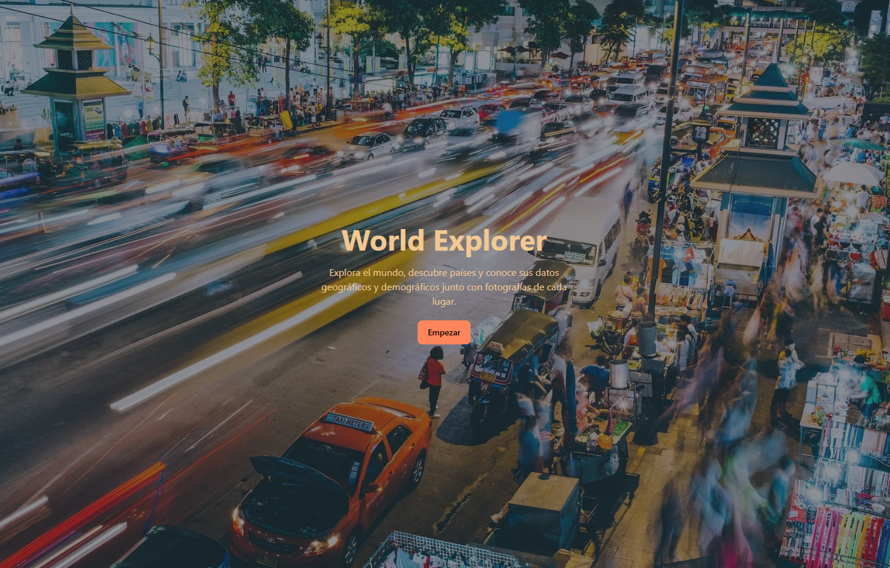
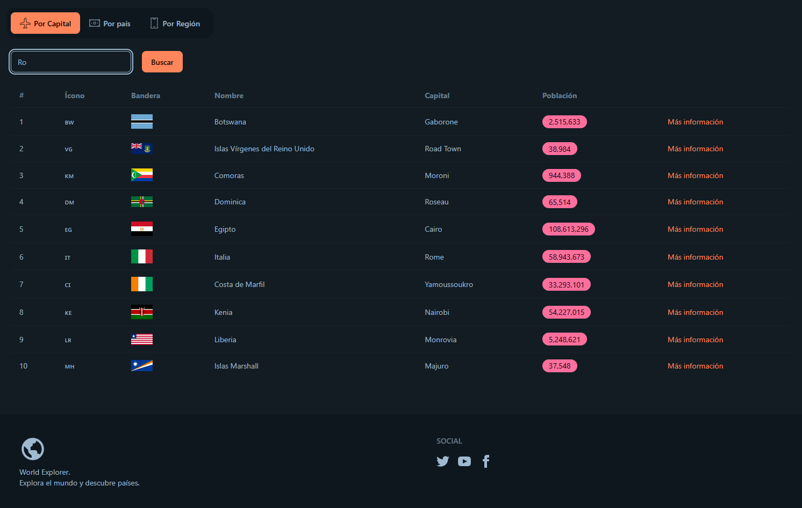
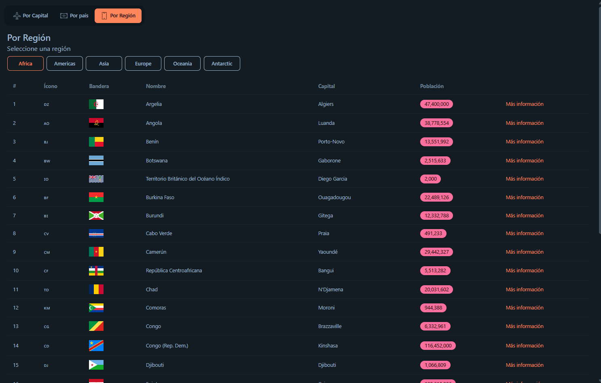
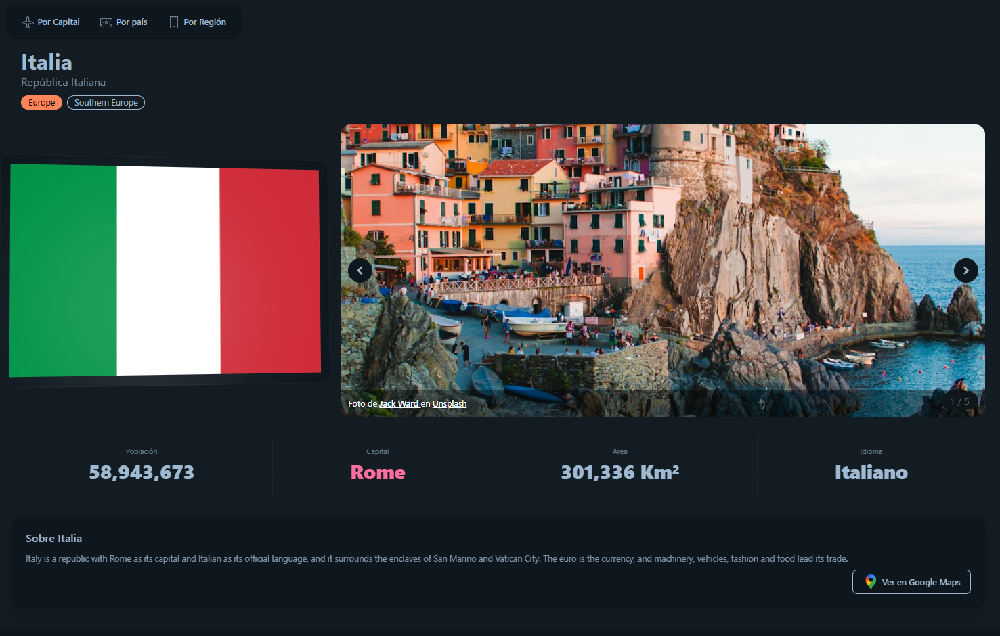

# 🌎 World Explorer

Aplicación web desarrollada con **Angular** que permite explorar países del mundo, consultar información geográfica y demográfica, y descubrir fotografías relacionadas con cada país.

El proyecto consume las API de **REST Countries** y **Unsplash** para ofrecer búsquedas, filtros y una vista detallada de cada país.

## 🚀 Demo

🌐 **[Ver World Explorer en Netlify](https://world-explorer-web.netlify.app/#/)**

## ✨ Funcionalidades

- 🔎 **Búsqueda por país:** encuentra países por su nombre.
- 🏙️ **Búsqueda por capital:** consulta países a partir del nombre de su capital.
- 🌍 **Búsqueda por región:** filtra países por África, América, Asia, Europa, Oceanía y la región Antártica.
- 🏳️ **Información detallada:** consulta la bandera, capital, población, superficie, región, idiomas y otros datos disponibles.
- 📸 **Galería de fotografías:** visualiza fotografías relacionadas con cada país mediante un carrusel interactivo.
- 🔗 **Atribución fotográfica:** enlaces al fotógrafo y a la fotografía original de Unsplash.
- 🗺️ **Ubicación en Google Maps:** acceso a la ubicación del país.
- 🧭 **Navegación entre vistas:** rutas para las búsquedas y las páginas de detalle.
- 📱 **Diseño adaptable:** interfaz desarrollada con Tailwind CSS y DaisyUI.

## 🛠️ Tecnologías

- Angular
- TypeScript
- RxJS
- Angular Signals y `rxResource`
- Angular Router
- Tailwind CSS
- DaisyUI
- REST Countries API v5
- Unsplash API

## 🧠 Conceptos de Angular aplicados

Durante el desarrollo puse en práctica los siguientes conceptos:

- Componentes standalone y organización por responsabilidades.
- Servicios para separar las peticiones HTTP de la presentación.
- Interfaces de TypeScript para tipar los datos de las API.
- Mappers para transformar los datos externos al modelo de la aplicación.
- Signals y `computed` para gestionar estado reactivo.
- `rxResource` para administrar datos obtenidos de forma asíncrona.
- `input()` para comunicar componentes.
- `ActivatedRoute` y parámetros de consulta para la navegación.
- Consumo de API REST mediante `HttpClient`.
- Renderizado condicional y ciclos de iteración con la sintaxis moderna de plantillas de Angular.

## 🚀 Instalación y ejecución

### Requisitos

- Node.js y npm.
- Una clave de acceso para REST Countries API v5.
- Una Access Key de Unsplash.

### 1. Clonar el repositorio

```bash
git clone https://github.com/AaronJasso12/world-explorer.git
cd world-explorer
```

### 2. Instalar dependencias

```bash
npm install
```

### 3. Configurar las variables de entorno

Utiliza `src/environments/environment.example.ts` como plantilla para configurar los archivos locales:

- `environment.ts`
- `environment.development.ts`

Configura las URLs y las claves de las API utilizando los nombres de propiedades que espera el proyecto.

Asegúrate de que los archivos con claves reales estén excluidos de Git y no sustituyas los valores de ejemplo por credenciales reales dentro del repositorio público.

### 4. Iniciar el servidor de desarrollo

```bash
npm start
```

Abre [http://localhost:4200](http://localhost:4200) en el navegador.

La aplicación se recargará automáticamente al realizar cambios en el código.

## 🏗️ Compilación

Para generar una compilación de producción:

```bash
npm run build
```

Los archivos generados se encontrarán dentro del directorio `dist/`, en la ruta configurada para el proyecto.

## 🔌 API utilizadas

### REST Countries API v5

Se utiliza para obtener información de los países y consultar los datos necesarios para las búsquedas y las páginas de detalle.

Documentación: [REST Countries](https://restcountries.com/)

### Unsplash API

Se utiliza para buscar fotografías relacionadas con los países y mostrar información de atribución del fotógrafo.

Documentación: [Unsplash API](https://unsplash.com/documentation)

Las fotografías incluyen enlaces al fotógrafo y a la imagen original, de acuerdo con la implementación del proyecto y las directrices aplicables de Unsplash.

## 🔐 Seguridad

Los archivos locales de configuración con claves reales están excluidos de Git mediante `.gitignore`.

**Importante:** las claves incluidas en una aplicación frontend pueden inspeccionarse desde el navegador. No incluyas claves secretas en el código cliente y revisa las condiciones de uso de cada API antes de desplegar la aplicación.

## 📚 Objetivo del proyecto

Este proyecto forma parte de mi portafolio de desarrollo frontend y tiene como objetivo poner en práctica Angular moderno, TypeScript, programación reactiva, consumo de API REST y creación de interfaces web.

## 📸 Capturas

### Portada de bienvenida



### Búsqueda por capital



### Filtrado por región



### Detalle de un país



---

Desarrollado como proyecto de aprendizaje y portafolio.
